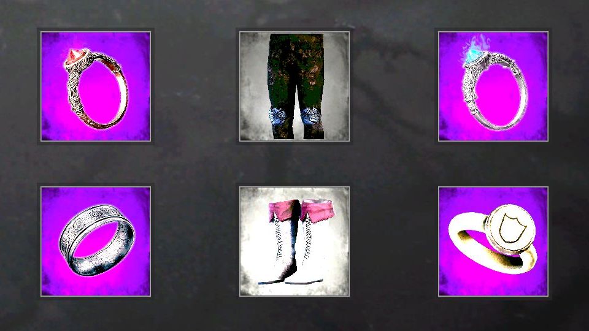

# Four Rings — Mono

Equip four rings in the existing equipment diagram in **Tainted Grail: The Fall of Avalon**.
The additional controls sit below the original ring controls, beside the boots control.

**Version 1.0.1 is tested on Mono 1.30.012. Other Mono builds are allowed but unverified.**
An unknown game assembly fingerprint produces a warning, not a version block.
Structural checks remain enabled and reject incompatible equipment layouts. IL2CPP is unsupported.

[Download the release](https://github.com/eugeny-dementev/avalon-four-rings/releases/latest) · [Nexus Mods](https://www.nexusmods.com/taintedgrailthefallofavalon/mods/391) · [Report a bug](https://github.com/eugeny-dementev/avalon-four-rings/issues/new/choose)



Actual gameplay capture from a disposable test profile. Inventory appearance includes separate UI customizations.
See the [complete inventory](docs/images/inventory-overview.png) and [additional-slot tooltip](docs/images/ring-interaction.png).

## Requirements

- Windows x64 and a Mono game installation.
- [BepInEx 5 x64](https://github.com/BepInEx/BepInEx/releases/tag/v5.4.23.6), tested with 5.4.23.6.
- Tested `Fall of Avalon_Data/Managed/TG.Main.dll` SHA-256, for reference only:

```text
57E9FBE5659B25539FDCF1A734F0C5CDE277FEDF36EEA6FEACB237855C69EE2A
```

No other mod or mod manager is required.

## Installation

1. Exit the game and back up your complete save profile.
2. Install BepInEx 5 x64 for the Mono game build.
3. Extract the release ZIP into the game directory beside `Fall of Avalon.exe`.
4. Confirm these files exist:

```text
BepInEx/patchers/FourRings/FourRings.Patcher.dll
BepInEx/plugins/FourRings/FourRings.Plugin.dll
```

5. Start the game and open the equipment diagram.

Both DLLs are required. Original game DLLs stay unchanged.
To update from 1.0.0, exit the game and replace both DLLs. Slot identifiers and saves remain unchanged.
The release contains no game libraries, mod loader, or test harness.
Manual installation is verified; Vortex installation is unverified.

## Behavior

- Four rings can provide their native equipment effects simultaneously.
- Native equip, unequip, requirements, inventory restrictions, and stacking rules remain in use.
- Automatic selection uses an empty ring slot first, then the game's original replacement behavior.
- Mouse actions, native tooltips, and controller navigation links use the existing game controls.
- Slots save through the native system with permanent names `FourRings_Ring3` and `FourRings_Ring4`.
- There is no adjustable slot count, separate equipment window, new hotkey, or live disable switch.

Physical gamepad input, actual merchant transactions, and combat-triggered ring effects remain unverified.
See the [test report](docs/TESTING.md) for evidence and limits.

## Safe removal

1. Load the save while both mod DLLs remain installed.
2. Unequip both additional ring slots.
3. Create a new manual save and exit the game completely.
4. Remove both Four Rings DLLs.
5. Load the cleaned manual save.

**Older saves containing equipped additional slots still require the mod.**
Restore both DLLs before loading those saves.
If a game update causes structural checks or plugin initialization to fail, avoid loading saves containing equipped additional slots.
Return to a compatible build or a save cleaned before the update.

## Troubleshooting

- Untested fingerprint: initialization continues with a warning. Compatibility with that Mono build is unverified.
- Structural or initialization error: the game APIs or equipment layout may be incompatible. Keep a save backup before testing.
- Only two slots: verify both DLL locations and inspect `BepInEx/LogOutput.log` for Four Rings messages.
- Report reproducible problems through [GitHub Issues](https://github.com/eugeny-dementev/avalon-four-rings/issues/new/choose).
- Share relevant log excerpts with personal paths and account information removed. Do not upload game DLLs or saves.

## Development and credits

See [build instructions](docs/BUILDING.md), [dependencies](docs/DEPENDENCIES.md), and [changes](CHANGELOG.md).
The original code is [MIT licensed](LICENSE). External dependencies retain their own licenses.
Game artwork and screenshots depict the game and are not grants to reuse its assets.

Credits: Questline and Awaken Realms for the game; BepInEx, Harmony, and Mono.Cecil contributors for their tools.

### AI disclosure

OpenAI Codex generated the original mod code, build scripts, tests, and documentation from the user's requirements.
Verification combined static checks, runtime tests, and interactive game inspection.
The screenshots are actual gameplay captures. No generated artwork or simulated UI is used.
